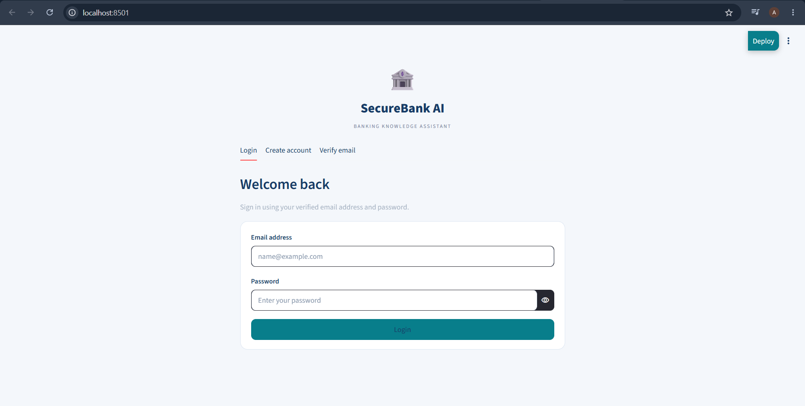
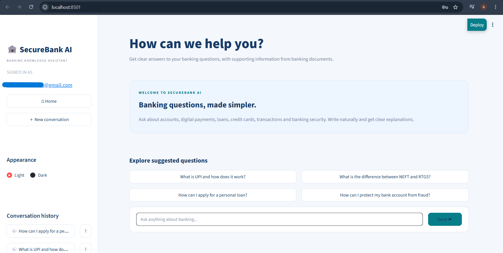
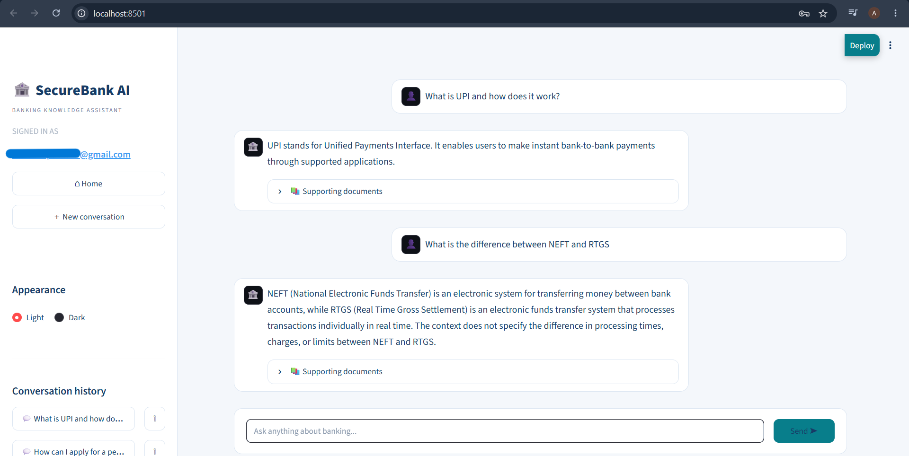
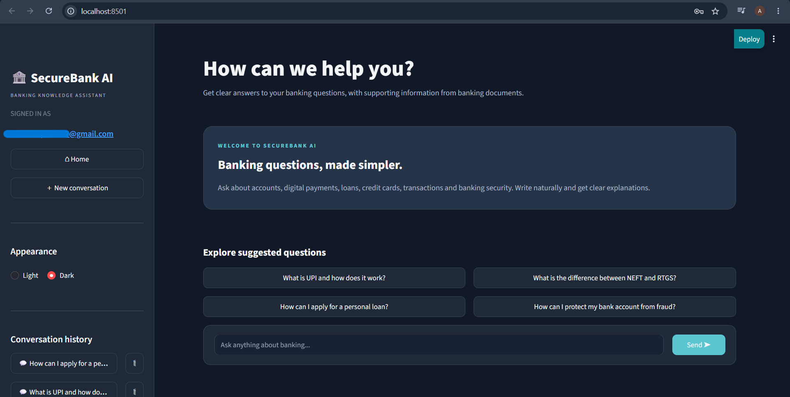
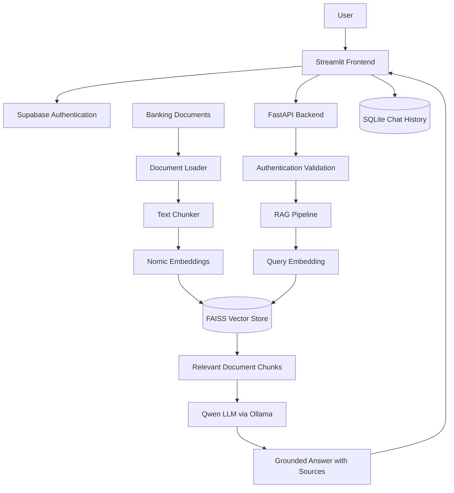

# SecureBank AI

### A Local-First RAG-Powered Banking Assistant

SecureBank AI is an intelligent banking assistant that uses **Retrieval-Augmented Generation (RAG)** to answer questions based on a knowledge base of banking documents.

Instead of relying only on an LLM's pretrained knowledge, the application retrieves relevant information from banking documents and uses that context to generate grounded responses.

The project combines a Streamlit frontend, FastAPI backend, local LLM inference using Ollama, FAISS vector search, and Supabase authentication to create an interactive AI application.

---

## Features

- **RAG-Based Question Answering:** Retrieves relevant information from banking documents before generating responses.
- **Local LLM Inference:** Runs language models locally using Ollama.
- **Semantic Document Search:** Uses embeddings and FAISS for similarity-based document retrieval.
- **Source-Aware Responses:** Displays supporting sources and relevant document excerpts.
- **User Authentication:** Supports registration, login, email verification, and logout through Supabase Auth.
- **Conversation History:** Maintains user-specific chat conversations using SQLite.
- **Modern Chat Interface:** Streamlit-based interface with light and dark themes.
- **REST API:** FastAPI backend with interactive API documentation.
- **User Isolation:** Authenticated conversations are scoped to the corresponding user.

---

## Application Screenshots

### Login and Authentication

The authentication interface supports login, account creation, and email verification.



### Home Dashboard

The home screen introduces the banking assistant and provides suggested questions to help users get started.



### AI Chat and RAG Responses

Users can ask banking-related questions and receive generated answers with expandable supporting document references.



### Dark Theme

The application also provides a dark theme for a consistent alternative interface.



---

## Technology Stack

| Category | Technologies |
|---|---|
| Programming Language | Python 3.11 |
| Frontend | Streamlit |
| Backend | FastAPI |
| LLM Runtime | Ollama |
| Language Model | Qwen |
| Embedding Model | Nomic Embed Text |
| Vector Store | FAISS |
| Authentication | Supabase Auth |
| Local Database | SQLite |
| API Communication | REST API, HTTP, JSON |
| Version Control | Git, GitHub |

---

## System Architecture

SecureBank AI follows a Retrieval-Augmented Generation architecture.



### RAG Workflow

1. **Document Ingestion:** Banking documents are loaded into the document processing pipeline.
2. **Text Chunking:** Documents are divided into smaller, manageable text chunks.
3. **Embedding Generation:** Nomic Embed Text converts document chunks into vector embeddings.
4. **Vector Storage:** FAISS stores the embeddings for efficient similarity-based retrieval.
5. **Query Processing:** The user's question is converted into an embedding.
6. **Context Retrieval:** FAISS retrieves relevant document chunks based on semantic similarity.
7. **Response Generation:** The Qwen language model running through Ollama generates an answer using the retrieved context.
8. **Source Presentation:** The generated response is displayed with supporting source information.
9. **Conversation Storage:** Chat history is maintained locally using SQLite.

---

## Project Structure

```text
SecureBankingAssistant/
│
├── backend/
│   ├── app/
│   │   ├── core/
│   │   │   ├── security.py
│   │   │   └── supabase_client.py
│   │   │
│   │   ├── routes/
│   │   │   ├── auth.py
│   │   │   └── chat.py
│   │   │
│   │   ├── schemas/
│   │   │
│   │   └── services/
│   │       ├── auth_service.py
│   │       ├── document_loader.py
│   │       ├── embedding_service.py
│   │       ├── llm_service.py
│   │       ├── rag_pipeline.py
│   │       ├── rag_service.py
│   │       ├── text_chunker.py
│   │       └── vector_store.py
│   │
│   └── main.py
│
├── frontend/
│   ├── app.py
│   └── auth_client.py
│
├── data/
│   └── documents/
│       ├── banking_fundamentals.txt
│       └── banking_policy.txt
│
├── screenshots/
│   ├── login.png
│   ├── home.png
│   ├── chat-response.png
│   └── dark-theme.png
│
├── tests/
│   ├── test_rag.py
│   ├── test_rag_evaluation.py
│   └── test_rag_service.py
│
├── .env.example
├── .gitignore
├── requirements.txt
└── README.md
```

---

## Getting Started

Follow these steps to run SecureBank AI locally.

### Prerequisites

Make sure you have the following installed:

- Python 3.11
- Git
- Ollama
- A Supabase account and project

### 1. Clone the Repository

```bash
git clone https://github.com/Nush25/securebank-ai.git
```

Navigate into the project directory:

```bash
cd securebank-ai
```

### 2. Create a Virtual Environment

```bash
python -m venv venv
```

Activate the environment on Windows PowerShell:

```powershell
.\venv\Scripts\Activate.ps1
```

### 3. Install Dependencies

```bash
pip install -r requirements.txt
```

### 4. Configure Environment Variables

Create a `.env` file in the project root.

Copy the example configuration:

```powershell
Copy-Item .env.example .env
```

Add your Supabase project credentials to `.env`:

```env
SUPABASE_URL=your_supabase_project_url
SUPABASE_PUBLISHABLE_KEY=your_supabase_publishable_key
APP_ENV=local
```

Replace the placeholder values with your own Supabase project details.

**Important:** Never upload your actual `.env` file or authentication secrets to GitHub.

### 5. Set Up Ollama

Install Ollama and download the required models:

```bash
ollama pull qwen3:4b
```

```bash
ollama pull nomic-embed-text
```

Make sure Ollama is running before starting the application.

The model configuration in the application should match the model names installed locally. Check `backend/app/services/llm_service.py` for the configured language model identifier.

### 6. Run the FastAPI Backend

Open a terminal in the project directory:

```bash
python -m uvicorn backend.main:app --reload
```

The backend will be available at:

`http://127.0.0.1:8000`

Interactive API documentation:

`http://127.0.0.1:8000/docs`

### 7. Run the Streamlit Frontend

Open another terminal and activate the virtual environment.

Run:

```bash
python -m streamlit run frontend/app.py
```

The application will open in your browser.

---

## API Endpoints

The backend exposes REST API endpoints for authentication and chat functionality.

| Endpoint | Method | Purpose |
|---|---|---|
| `/health` | GET | Check backend health |
| `/auth/register` | POST | Register a new user |
| `/auth/login` | POST | Authenticate a user |
| `/auth/logout` | POST | Log out a user |
| `/chat` | POST | Send a question to the AI assistant |

For the complete API schema and request details, visit:

`http://127.0.0.1:8000/docs`

---

## Security Considerations

- Supabase Auth handles user authentication.
- Protected backend endpoints validate authentication tokens.
- Conversation access is scoped to the authenticated user.
- Local chat history and generated data are excluded from version control.
- Ollama provides local language model inference.
- Environment variables are used for application configuration.
- Never enter real banking passwords, PINs, OTPs, or confidential financial information.

---

## Future Improvements

Potential enhancements include:

- Improved RAG retrieval and reranking.
- Expanded banking document knowledge base.
- More comprehensive automated evaluation.
- Conversation export functionality.
- Improved response evaluation and hallucination detection.
- Deployment using a hosted inference service.

---

## Disclaimer

SecureBank AI is an educational and portfolio project. It uses sample banking documents and is not connected to real banking systems.

The generated responses should not be treated as official banking instructions or financial advice.

Do not use this application with real customer information or sensitive financial credentials.

---

## Author

**Anushka Patil**

- GitHub: [@Nush25](https://github.com/Nush25)
- Project Repository: [SecureBank AI](https://github.com/Nush25/securebank-ai)

---

*Built to explore Retrieval-Augmented Generation, Large Language Models, semantic search, API development, and AI application engineering.*